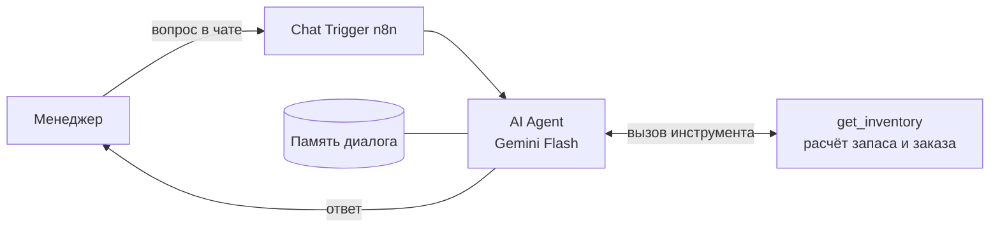

# ИИ-ассистент по остаткам и поставкам для маркетплейса

Менеджеру по закупкам не нужно вручную считать, на сколько дней хватит товара и сколько заказать. Он задаёт вопрос в чате на русском языке, а ассистент отвечает по данным об остатках и продажах.

Проект сделан на **n8n** и **Google Gemini Flash**. Данные в проекте вымышленные (20 товаров).

## Что умеет

- Показывать, что нужно срочно заказать, и объяснять почему
- Считать количество к заказу по любому артикулу
- Готовить короткий отчёт для руководителя: сколько позиций срочных, какой объём заказать, где затоварка
- Помнить контекст диалога («а по второй позиции?»)

Примеры вопросов:

- «Что нужно срочно заказать?»
- «Сколько заказать по SKU-005?»
- «Где у нас затоварка?»
- «Сделай короткий отчёт для руководителя»

## Как устроено



**Главный принцип: цифры считает код, а не нейросеть.** Нейросеть может ошибиться в арифметике, поэтому она только понимает вопрос, вызывает инструмент `get_inventory` и пересказывает результат. В системном промпте прямо запрещено придумывать и пересчитывать числа, а если данных нет, ассистент должен так и сказать.

## Как считается

- Продажи в день = продажи за 30 дней / 30
- Запас в днях = остаток / продажи в день
- Количество к заказу = (срок поставки + 14 дней страхового запаса) × продажи в день − остаток
- Статусы:
  - **СРОЧНО**: запаса хватит на меньше дней, чем идёт поставка
  - **СКОРО**: запас закончится в пределах срока поставки + 14 дней
  - **ЗАТОВАРКА**: запаса больше чем на 90 дней
  - **ОК**: остальное

## Что видно на тестовых данных

Срочных позиций: 5, затоваренных: 5, всего к заказу: 766 шт.

| Артикул | Товар | Остаток | Хватит на (дн.) | Срок поставки (дн.) | Заказать (шт.) |
|---|---|---|---|---|---|
| SKU-010 | Автодержатель магнитный | 28 | 6.5 | 14 | 94 |
| SKU-002 | Защитное стекло для iPhone 15 | 85 | 9.8 | 14 | 158 |
| SKU-014 | Колонка Bluetooth mini | 33 | 11.0 | 30 | 99 |
| SKU-005 | Power bank 10000 mAh | 60 | 12.0 | 25 | 135 |
| SKU-004 | Наушники TWS Air Pro | 120 | 17.1 | 25 | 153 |

## Запуск за 5 минут

1. Установите n8n: [n8n Cloud](https://n8n.io) или локально командой `npx n8n`
2. Workflows → Import from file → `workflow/inventory-assistant.n8n.json`
3. В узле **Gemini Flash** создайте credential: API-ключ из [Google AI Studio](https://aistudio.google.com)
4. Нажмите **Open chat** и задайте вопрос

## Структура репозитория

```
data/inventory.csv                       тестовые данные (20 товаров)
workflow/inventory-assistant.n8n.json    workflow для импорта в n8n
prompts/system_prompt.md                 системный промпт и описание инструмента
```

## Как развивать

- Брать данные из Google Sheets или API маркетплейса вместо встроенных
- Подключить WhatsApp или Telegram вместо чата n8n
- Присылать утренний отчёт по срочным позициям автоматически
- Добавить анализ рекламных кампаний и сверку выплат

<!--
## Демо
Когда добавите файлы в папку docs/, раскомментируйте:


-->

Автор: Шынгыс Рысбеков
